# Laporan Praktikum 9 — Keranjang Session, Login Aman, dan Token CSRF

Nama : NASIFA ZARIAH
NIM  : 25110198
Kelas: TK Grup D
Versi PHP: 8.2.12

## 1. Lingkungan
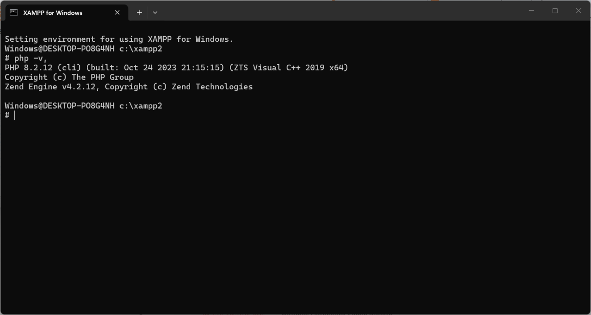

## 2. Keranjang berbasis session
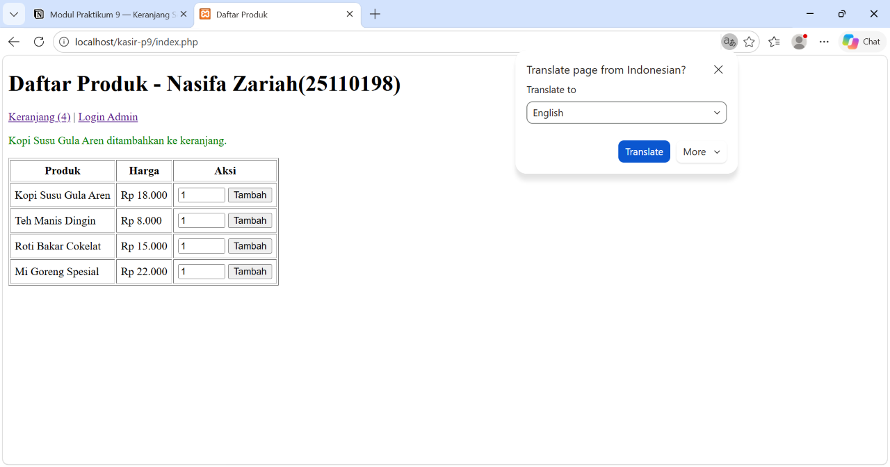
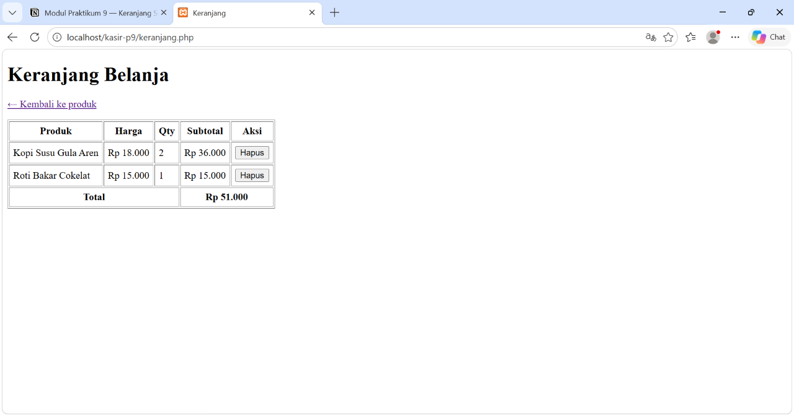
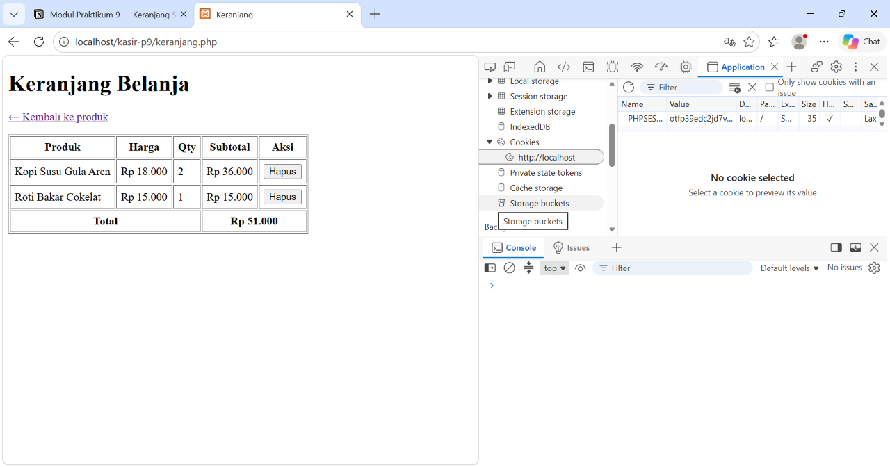

## 3. Login dengan password hash
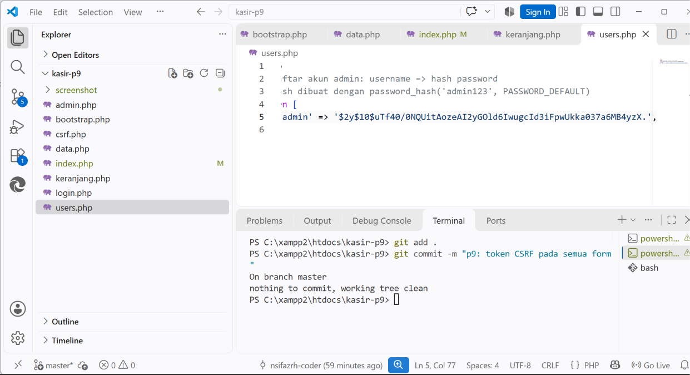
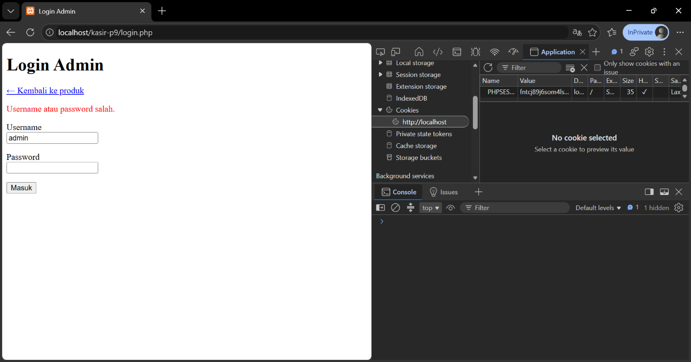
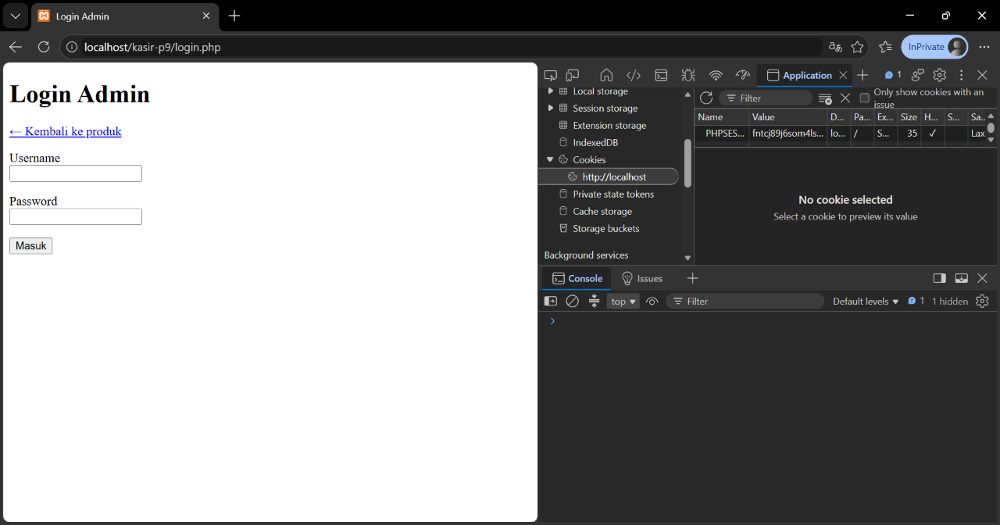
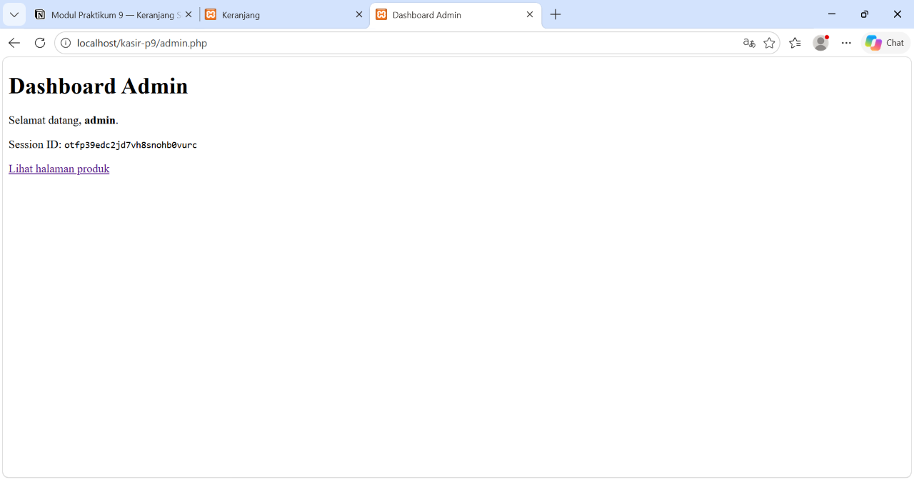

## 4. Token CSRF
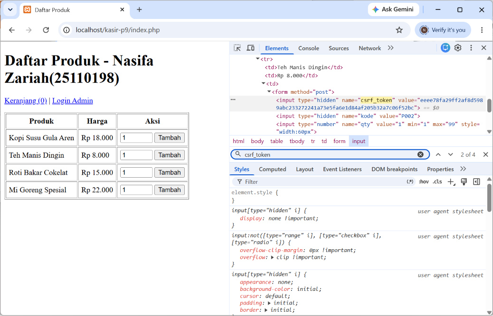
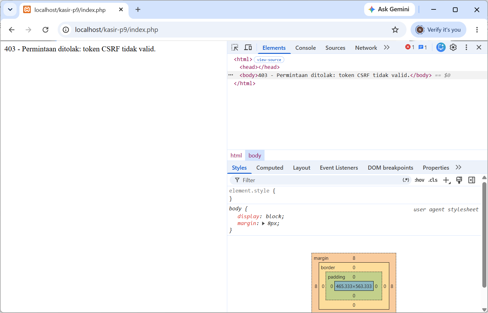
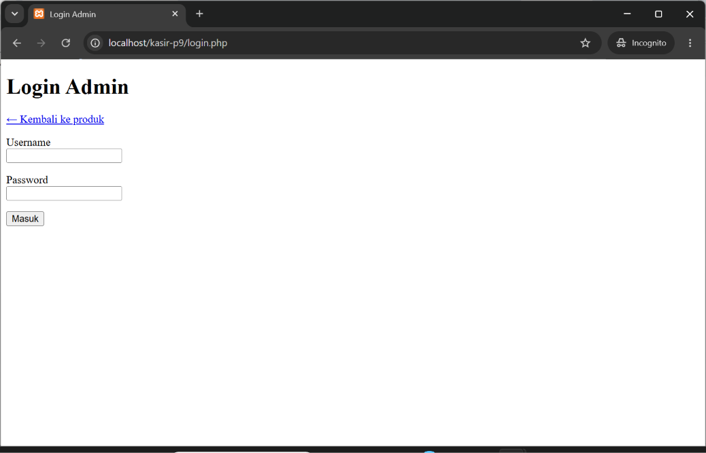

## 5. Hasil uji fungsional
| No | Uji | Hasil (Lulus/Gagal) |
|----|-----|---------------------|
| 1 | Keranjang bertahan | lulus |
| 2 | Password tersimpan sebagai hash | lulus |
| 3 | Regenerasi session | lulus |
| 4 | Tolak request tanpa token | lulus |
| 5 | Pesan login umum | lulus |
| 6 | Halaman terproteksi | lulus |

## 6. Pertanyaan
1. Mengapa isi keranjang tidak terlihat di cookie browser?
   Jawab:  Karena keranjang disimpan di $_SESSION di server, bukan di cookie. Cookie di browser hanya menyimpan PHPSESSID (ID session) saja. Jadi meskipun cookie dilihat, isinya tidak terlihat dan tidak bisa diubah dari browser.
2. Apa yang terjadi jika baris session_regenerate_id(true) dihapus?
   Jawab: ID session tidak berubah setelah login, sehingga rentan terhadap serangan Session Fixation. Penyerang yang sudah mengetahui ID session lama bisa memakai ID tersebut untuk masuk sebagai korban setelah korban login.
3. Mengapa tombol Hapus dibuat dengan form POST, bukan link?
   Jawab: Karena Hapus adalah aksi yang mengubah data. Kalau pakai link (GET), bisa terhapus tidak sengaja hanya dengan diklik / di-refresh / di-crawl bot, dan tidak bisa dilindungi token CSRF. Dengan form POST + token CSRF, penghapusan hanya terjadi jika memang sengaja dikirim dari form yang sah.